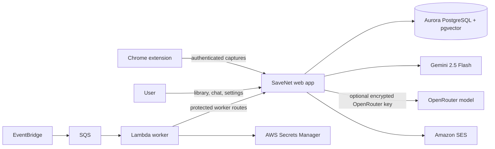

# SaveNet

[SaveNet](https://savenet.am1.tech) is an AI-powered, searchable library for posts and links a user saves across social media (Instagram and X for now), browser bookmarks, and reading list items. This app stores and enriches the posts collected from the [accompanying extension](https://chromewebstore.google.com/detail/savenet-save-smarter-find/kmbfnbpogmgfmlohnajkpmeicocpedof), then lets the user browse and ask questions about them.

## SaveNet Web

This repository `savenet-web` contains the Next.js app and its server-side capture, search, chat, and authentication functionality. The companion Chrome extension captures Instagram saves, X bookmarks, browser bookmarks, and Reading List items. The extension lives in the [`savenet-extension`](https://www.github.com/hrmtsh2/savenet-extension) repo.

- accepts authenticated captures from the extension
- stores posts in Aurora PostgreSQL with pgvector embeddings
- stores captured thumbnails in a private S3 bucket and serves them through an authenticated image route
- adds source and collection labels to saved posts
- uses OCR and captured context to make image-based posts searchable
- provides a paginated library, label management, keyword search, and chat answers that link back to saved posts
- lets users keep Gemini 2.5 Flash as the default model or bring an OpenRouter API key and model of their choice
- runs label-specific label agents, view-wide auto-labelling, and optional email digests
- authenticates the web app through Amazon Cognito and NextAuth

User-provided model keys are encrypted before storage.
The asynchronous agent and digest worker is defined separately in [`savenet-infra`](https://www.github.com/hrmtsh2/savenet-infra).
It uses EventBridge, SQS, Lambda, and AWS Secrets Manager to call this app's workers, through protected routes.

## Stack

- Next.js 16, React 19, TypeScript, Tailwind CSS, and Base UI
- Amazon Cognito with NextAuth
- Aurora PostgreSQL, pgvector, and AWS RDS IAM authentication through Vercel OIDC
- Vercel AI SDK, Google Gemini, and OpenRouter
- Amazon SES for email delivery
- EventBridge, SQS, and Lambda for scheduled background work

## Architecture



The web app owns capture, retrieval, model settings, and agent state.
The worker only schedules and invokes protected routes, so the same app can move away from Vercel without changing the background-job design.

### Thumbnail storage configuration

Apply [`scripts/011-add-thumbnail-storage.sql`](./scripts/011-add-thumbnail-storage.sql) after deploying the schema changes. Deploy the infrastructure stack with `WEB_RUNTIME_ROLE_ARN` set to the Vercel runtime role ARN, then set the resulting `ThumbnailBucketName` output as `SAVENET_THUMBNAIL_BUCKET` in the web app. The bucket remains private; the web runtime needs `s3:GetObject` and `s3:PutObject` permissions on it.

## Project structure

```text
app/
  api/                 capture and chat routes for the extension
  actions.ts           session-authenticated server actions
  library/             paginated library of saved posts
  chat/                cited chat interface
  categories/          label management
  settings/            model, agent, and digest settings
components/            application and Base UI components
lib/
  agents.ts            entity-resolution and auto-labelling runs
  ai.ts                capture and chat AI utilities
  ai-credentials.ts    encrypted OpenRouter credentials
  ai-settings.ts       model preferences and AI usage records
  auth.ts              NextAuth and extension authentication helpers
  chat.ts              retrieval and chat orchestration
  db.ts                Aurora connection pool and RDS IAM signing
  digests.ts           digest generation and scheduling checks
  queries.ts           database queries
scripts/               manually applied SQL migrations
```
